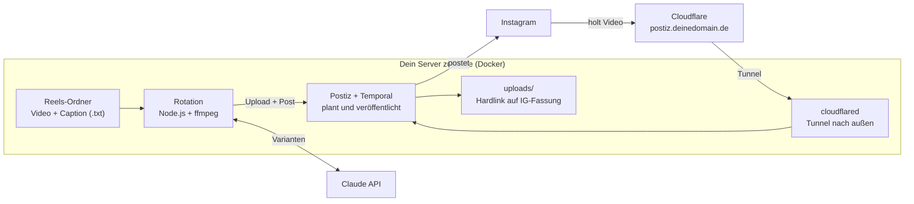

# Instagram-Reels automatisch posten mit Postiz

Ein kleiner Server bei dir zuhause postet zweimal am Tag automatisch ein Reel als Instagram Trial Reel, jedes Mal mit einer anderen Caption. Du legst nur Video und Caption in einen Ordner, den Rest erledigt das System.

Die Bausteine:

- **[Postiz](https://github.com/gitroomhq/postiz-app)**: Open-Source-Tool zum Planen von Social-Media-Posts. Es spricht mit der Instagram-API und veröffentlicht zur geplanten Zeit.
- **Cloudflare Tunnel**: macht Postiz aus dem Internet erreichbar, ohne Ports am Router zu öffnen. Instagram lädt das Video beim Posten selbst von deinem Server, deshalb ist das nötig.
- **Rotations-Script** ([`rotation/rotate.mjs`](rotation/rotate.mjs), Node.js): sucht das nächste Reel aus, rechnet es mit ffmpeg auf Instagram-Format um, lädt es zu Postiz hoch und plant es ein.
- **Claude** (optional): schreibt pro Reel vier Caption-Varianten, damit nicht jedes Mal derselbe Text kommt.

Alles läuft in Docker-Containern, auf jedem Linux-Rechner, der dauerhaft läuft (Mini-PC, NAS, Raspberry Pi 5).



Instagram bekommt das Video nicht geschickt, sondern holt es beim Veröffentlichen selbst über Cloudflare von deinem Server ab.

> **Ehrlicher Hinweis vorweg:** Technisch funktioniert alles. Instagram markiert Trial Reels, die per API kommen und deren Video schon einmal auf deinem Account lief, aber oft mit „ähnelt einem anderen Beitrag“ und zeigt sie weniger Leuten. Am besten eignet sich das System deshalb für **neue** Videos. Mehr dazu unter [Stolperfallen](#stolperfallen).

## Inhalt

- [Voraussetzungen](#voraussetzungen)
- [Schritt 1: Postiz aufsetzen](#schritt-1-postiz-aufsetzen)
- [Schritt 2: Cloudflare Tunnel einrichten](#schritt-2-cloudflare-tunnel-einrichten)
- [Schritt 3: Instagram verbinden und API-Key holen](#schritt-3-instagram-verbinden-und-api-key-holen)
- [Schritt 4: Die Rotation starten](#schritt-4-die-rotation-starten)
- [Wie die Rotation arbeitet](#wie-die-rotation-arbeitet)
- [Videos Instagram-tauglich machen](#videos-instagram-tauglich-machen)
- [Stolperfallen](#stolperfallen)
- [Betrieb](#betrieb)

## Voraussetzungen

Du brauchst einen Rechner, der rund um die Uhr läuft, eine eigene Domain bei Cloudflare und einen Instagram-Account, der mit einer Facebook-Seite verknüpft ist.

| Was | Wofür | Hinweis |
| --- | --- | --- |
| Linux-Rechner mit Docker und Docker Compose | Postiz und Rotation laufen dort | Das Postiz-Image allein ist ca. 4,5 GB, plane mindestens 15 GB für Docker ein. |
| Große Platte oder SSD | Videos und Uploads | 4K-Reels haben 250–400 MB. Lege sie nicht auf einen kleinen internen eMMC-Speicher. |
| Instagram-Professional-Account (Creator oder Business) | Posten per API | Muss mit einer Facebook-Seite verknüpft sein. |
| Meta-Developer-App | Postiz bekommt damit Zugriff auf Instagram | Kostenlos unter developers.facebook.com. |
| Domain bei Cloudflare | öffentliche Adresse für Postiz | Kostenloser Cloudflare-Plan reicht. |
| Anthropic-API-Key (optional) | Caption-Varianten mit Claude | Ohne Key nutzt das Script nur deine Original-Caption. |

ffmpeg musst du nicht installieren, es steckt im Image der Rotation. Du solltest dich im Terminal wohlfühlen und eine `docker-compose.yaml` lesen können. Programmieren musst du nicht.

## Schritt 1: Postiz aufsetzen

Postiz besteht aus sieben Containern: Postiz selbst, eine Postgres-Datenbank, Redis und der Temporal-Stack (Temporal, eigene Postgres, Elasticsearch), der die geplanten Posts abarbeitet. Die [`docker-compose.yaml`](docker-compose.yaml) in diesem Repo basiert auf [gitroomhq/postiz-docker-compose](https://github.com/gitroomhq/postiz-docker-compose) und enthält schon alles, auch die Rotation.

1. Repo klonen und Ordner für Videos anlegen:
   ```
   git clone <URL dieses Repos> postiz && cd postiz
   mkdir -p media/reels media/uploads
   ```
   `media/` sollte auf einer großen Platte liegen. Entweder klonst du das Repo direkt dorthin oder du ersetzt `./media` in der Compose-Datei durch einen absoluten Pfad.
2. `.env` anlegen und ausfüllen. Sie kommt nie in Git:
   ```
   cp .env.example .env
   ```
   `JWT_SECRET` und `POSTGRES_PASSWORD` erzeugst du mit `openssl rand -hex 32`. Die restlichen Werte kommen in den nächsten Schritten.
3. In der `docker-compose.yaml` ersetzen: `postiz.deinedomain.de` durch deine Domain, `DEINE_META_APP_ID` durch die App-ID aus Schritt 3 und bei `FILE_OWNER` die Ausgabe von `id -u`:`id -g` deines Users.
4. Starten mit `docker compose up -d postiz cloudflared`. Der erste Start dauert ein paar Minuten.
5. Sobald Schritt 2 steht: Postiz über deine Domain öffnen, Account anlegen, dann in der `.env` `DISABLE_REGISTRATION=true` setzen und `docker compose up -d` erneut ausführen. Sonst kann sich jeder auf deinem Server registrieren.

## Schritt 2: Cloudflare Tunnel einrichten

Der Tunnel macht Postiz unter deiner Domain erreichbar, ohne dass du am Router Ports öffnest: Der Container baut die Verbindung selbst nach außen zu Cloudflare auf.

1. Im Cloudflare-Dashboard unter **Zero Trust → Networks → Tunnels** einen neuen Tunnel vom Typ „Cloudflared“ anlegen.
2. Als Umgebung Docker wählen. Aus dem angezeigten Befehl alles nach `--token` kopieren und als `TUNNEL_TOKEN` in die `.env` eintragen.
3. Unter **Public Hostname** eine Route anlegen: `postiz.deinedomain.de` → Service `http://postiz:5000`.
4. `docker compose up -d cloudflared`, dann `https://postiz.deinedomain.de` im Browser öffnen.

Der Service heißt `postiz:5000`, weil beide Container im selben Docker-Netz hängen. Den Tunnel-Token behandelst du wie ein Passwort.

## Schritt 3: Instagram verbinden und API-Key holen

Postiz postet über eine eigene Meta-App auf deinen Instagram-Account. Die App bleibt im Entwicklungsmodus, für deinen eigenen Account brauchst du keine App-Prüfung durch Meta.

1. Auf [developers.facebook.com](https://developers.facebook.com/) eine neue App vom Typ **Business** anlegen.
2. Das Produkt **Facebook Login for Business** hinzufügen. Als gültige OAuth-Weiterleitungs-URI eintragen: `https://postiz.deinedomain.de/integrations/social/instagram`
3. Die Berechtigungen, die Postiz anfragt: `instagram_basic`, `instagram_content_publish`, `instagram_manage_comments`, `instagram_manage_insights`, `pages_show_list`, `pages_read_engagement`, `business_management`.
4. Unter **App-Einstellungen → Allgemeines** App-ID und App-Geheimcode kopieren. Die ID kommt als `FACEBOOK_APP_ID` in die Compose-Datei, der Geheimcode als `FACEBOOK_APP_SECRET` in die `.env`. Danach `docker compose up -d postiz`.
5. In Postiz **Add Channel → Instagram (Facebook Business)** wählen, bei Facebook anmelden, die Seite und den damit verknüpften Instagram-Account auswählen.
6. Test: in Postiz eine Story oder ein Bild per Hand veröffentlichen. Klappt das, steht die Verbindung.
7. API-Key für die Rotation: **Settings → Public API** öffnen, Key kopieren und als `POSTIZ_API_KEY` in die `.env` eintragen.

Nimm „Instagram (Facebook Business)“ und nicht „Instagram (Standalone)“: Nur so ist der Account sauber mit der Facebook-Seite verknüpft, über die die Graph-API veröffentlicht.

## Schritt 4: Die Rotation starten

1. Abhängigkeiten installieren (nur `@anthropic-ai/sdk`):
   ```
   cd rotation && npm install && cd ..
   ```
   Ohne lokales Node geht es auch so: `docker run --rm -v "$PWD/rotation:/app" -w /app node:22-alpine npm install`
2. Optional `ANTHROPIC_API_KEY` in die `.env` eintragen.
3. Erstes Reel ablegen: `media/reels/morgenroutine.mp4` und `media/reels/morgenroutine.txt` mit der Caption.
4. Testlauf, der nichts einplant:
   ```
   docker compose run --rm reel-rotation --dry-run
   ```
5. Rotation starten:
   ```
   docker compose up -d --build reel-rotation
   docker compose logs -f reel-rotation
   ```

Einstellungen stehen in der `docker-compose.yaml` beim Service `reel-rotation`:

| Variable | Standard | Bedeutung |
| --- | --- | --- |
| `SLOTS` | `12:00,18:00` | Uhrzeiten (lokal) |
| `TIMEZONE` | `Europe/Berlin` | Zeitzone |
| `GRADUATION_STRATEGY` | `MANUAL` | `MANUAL`: du gibst in der App an Follower frei. `SS_PERFORMANCE`: Instagram entscheidet nach Performance. |
| `CAPTION_VARIANTS` | `4` | Anzahl Claude-Varianten, `0` = aus |
| `LOOKAHEAD_HOURS` | `36` | wie weit im Voraus eingeplant wird |
| `USE_ORIGINAL_CAPTION` | `false` | Original-Caption mitrotieren |
| `TRANSCODE` | `true` | Videos vor dem Upload auf Instagram-Format rechnen |

## Wie die Rotation arbeitet

Das Script prüft alle 10 Minuten, ob in den nächsten 36 Stunden ein Slot frei ist, und plant ihn über die Public API von Postiz ein.

**Ablauf pro freiem Slot:**

1. Reels einlesen: jede `name.mp4` mit einer nicht leeren `name.txt` daneben. Ohne Caption wird ein Reel übersprungen.
2. Reel wählen: das, das am längsten nicht dran war. Nie gepostete kommen zuerst.
3. Caption wählen: beim ersten Einsatz schreibt Claude vier Varianten nach `rotation/variants/name.json`, danach rotiert das Script durch diese Varianten.
4. Video umrechnen und hochladen (siehe unten), dann den Post anlegen.
5. Alles in `rotation/data/state.json` merken, damit kein Slot doppelt belegt und kein Video doppelt hochgeladen wird.

**Die zwei Postiz-API-Aufrufe** (Basis `http://postiz:5000/api/public/v1`, Header `Authorization: <POSTIZ_API_KEY>`):

```js
// 1. Video hochladen (multipart/form-data, Feld "file") → { id, path }
const media = await api("POST", "/upload", form, true);

// 2. Post einplanen (type "now" postet sofort)
await api("POST", "/posts", {
  type: "schedule",
  date: "2026-11-24T11:00:00.000Z",
  shortLink: false,
  tags: [],
  posts: [{
    integration: { id: integrationId },          // aus GET /integrations
    value: [{ content: "<p>Caption</p>", image: [{ id: media.id, path: media.path }] }],
    settings: { post_type: "post", is_trial_reel: true, graduation_strategy: "MANUAL" },
  }],
});
```

**Caption-Varianten mit Claude:** Das Script schickt die Original-Caption an die Claude-API und bekommt per strukturierter Ausgabe (JSON-Schema) genau vier Varianten zurück. Der Systemprompt verlangt: gleiche Aussage und Fakten, keine neuen Hashtags, anderer Hook in der ersten Zeile, höchstens 2200 Zeichen. Die JSON-Datei darfst du von Hand nachbessern. Änderst du die `.txt`, werden die Varianten neu erzeugt, außer du entfernst `source_hash` aus der JSON-Datei.

## Videos Instagram-tauglich machen

Die Rotation rechnet jedes Video vor dem Upload auf 1080 px Breite und 10 Mbit/s um, sonst lehnt Instagram es mit „Video download failed“ ab. iPhone-Reels sind meist 4K mit 60 Mbit/s. Instagram erlaubt über die API höchstens 1920 px Breite und 25 Mbit/s und hat größere Dateien bei mir nur anfangs manchmal toleriert.

Das Ergebnis landet in `media/reels/.instagram/name.mp4`, deine Originale bleiben unverändert. Der ffmpeg-Aufruf dahinter:

```
ffmpeg -i reels/montag.mp4 \
  -map 0:v:0 -map 0:a:0? \
  -vf "scale=w=if(gte(ih\,iw)\,min(1080\,iw)\,min(1920\,iw)):h=-2" \
  -fpsmax 60 \
  -c:v libx264 -preset veryfast -profile:v high -pix_fmt yuv420p \
  -b:v 10M -maxrate 12M -bufsize 24M \
  -c:a aac -b:a 160k -ar 48000 \
  -movflags +faststart \
  reels/.instagram/montag.mp4
```

| Einstellung | Wirkung |
| --- | --- |
| `scale=…` | Hochformat auf 1080 px Breite, Querformat auf 1920, nie hochskalieren |
| `-pix_fmt yuv420p` | macht aus 10-Bit-HEVC vom iPhone normales 8-Bit-H.264 |
| `-b:v 10M -maxrate 12M` | deutlich unter dem Limit von 25 Mbit/s |
| `-movflags +faststart` | Instagram kann das Video lesen, bevor es komplett geladen ist |

Auf einem Intel N150 dauert das etwa 1–1,5 Minuten pro Reel. Ein 55-Sekunden-Reel schrumpft dabei von 415 auf 71 MB.

**Hardlinks statt doppelter Dateien:** Postiz legt beim Upload eine eigene Kopie in `uploads/` ab, denn von dort holt Instagram das Video. Das Script ersetzt diese Kopie direkt nach dem Upload durch einen Hardlink auf `reels/.instagram/name.mp4`. Beide Namen zeigen dann auf dieselben Daten auf der Platte, das Video belegt nur einmal Platz. Vorher vergleicht das Script beide Dateien Byte für Byte und ersetzt atomar (Link auf einen temporären Namen, dann umbenennen), damit Postiz nie eine fehlende Datei sieht.

## Stolperfallen

Die meisten Fehler waren still: Alles sah grün aus, und trotzdem kam nichts auf Instagram an.

| Problem | Symptom | Lösung |
| --- | --- | --- |
| Postiz startet vor Temporal (nach jedem Reboot) | Container „healthy“, Posts bleiben auf QUEUE, im Log „Failed to create connection“ | Postiz wartet beim Start, bis Temporal erreichbar ist (der `command` in der Compose-Datei). `depends_on` hilft nicht, weil Docker nach einem Reboot alles gleichzeitig startet. |
| 4K-Videos zu groß | Post auf ERROR mit „Instagram Video download failed“ | Vorher umrechnen, macht die Rotation automatisch |
| iPhone-Videos als .mov | Upload in Postiz scheitert mit „Unsupported file type“ | Postiz prüft den Dateiinhalt, nicht die Endung. Das Umrechnen erzeugt ohnehin echtes MP4. |
| Hardlink scheitert | „EXDEV: cross-device link not permitted“ | `reels/` und `uploads/` müssen im selben Docker-Mount liegen, auch wenn sie auf derselben Platte sind |
| Keine Schreibrechte in `uploads/` | Hardlink scheitert mit „EACCES“ | Postiz legt die Ordner als root an. Rotation als root laufen lassen und eigene Dateien per `FILE_OWNER` an deinen User zurückgeben. |
| Volle Systemplatte | Container starten nicht mehr | Docker-Images und Datenbanken brauchen schnell 10 GB und mehr. Uploads und Videos gehören auf eine große Platte. |
| „Ähnelt einem anderen Beitrag“ | Instagram zeigt das Trial Reel weniger Leuten | Siehe unten |

**Die Sache mit „ähnelt einem anderen Beitrag“:** Laut Instagrams Hilfe kann ein Trial Reel aus Inhalten, die du schon geteilt hast, weniger Reichweite bekommen. Bei mir kam die Warnung bei jedem bereits veröffentlichten Video, egal mit welcher Caption. Über die Edits-App kam sie bei denselben Videos nicht. Ob Edits sie nur nicht anzeigt oder die Reichweite dort wirklich nicht begrenzt, ist offen. Mein Rat: Nutze die Rotation für neue Videos, nicht um alte Reels wiederzuverwerten.

## Betrieb

Im Alltag legst du nur Reels nach und schaust ab und zu ins Log.

**Reel nachlegen:** zwei Dateien in den Reels-Ordner kopieren, zum Beispiel per `scp`:

```
scp morgenroutine.mp4 morgenroutine.txt server:~/postiz/media/reels/
```

Die `.txt` enthält die Caption, gern mehrzeilig, Hashtags am Ende. Beim nächsten freien Slot rechnet die Rotation das Video um, lässt Varianten schreiben und plant es ein.

**Nützliche Befehle** (im Repo-Ordner):

| Befehl | Wofür |
| --- | --- |
| `docker compose logs -f reel-rotation` | Log der Rotation verfolgen |
| `docker compose run --rm reel-rotation --dry-run` | Testlauf: zeigt, was eingeplant würde |
| `docker compose run --rm reel-rotation --post-now` | Nächstes Reel sofort posten |
| `docker compose run --rm reel-rotation --post-now --reel=montag` | Bestimmtes Reel sofort posten |
| `docker compose stop reel-rotation && docker compose run --rm reel-rotation --replan && docker compose up -d reel-rotation` | Künftige Slots löschen und neu einplanen |
| `docker compose logs --tail=100 postiz` | Postiz-Log, z. B. bei hängenden Posts |

**Woran du ein Problem erkennst:** Ein Post bleibt im Postiz-Kalender auf „Queue“, obwohl seine Zeit vorbei ist. Dann ist meist der Orchestrator nicht mit Temporal verbunden. `docker compose restart postiz` behebt das.

## Lizenz

[MIT](LICENSE). Postiz selbst steht unter eigener Lizenz, siehe [gitroomhq/postiz-app](https://github.com/gitroomhq/postiz-app).
